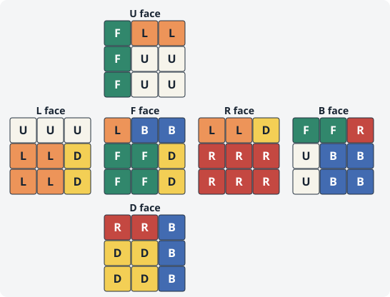

# CSIRE Rubik’s Cube Solver

A modern renewal of **Implementation of Solving a Rubik’s Cube Using Group Theory**, a high-school CSIRE project by **Alyna Tang and Mingpu (Andy) Wu**, mentored by **Professor David Gu at Stony Brook University**. Given a legal 3×3×3 cube, the program prints a sequence of face turns and verifies the result by replaying it.

## Try it

Use Python 3.9 or later. Everything runs locally with the Python standard library. Open a terminal in this folder and enter:

```sh
python solve_cube.py solve "R U R' U'"
```

The final two lines are:

```text
Solution (4 moves): U R U' R'
Replay: solved
```

For a longer demonstration that exercises all four search phases:

```sh
python solve_cube.py random --length 25 --seed 42
```

Use `U R F D L B` for clockwise quarter-turns as viewed looking at the named face. Append a prime (`R'`) for a counterclockwise turn or `2` for a half turn. Separate turns with spaces. A half turn counts as one move. The random command uses successive face turns and avoids consecutive turns of the same face.

## From the original project to the renewal

The joint midterm outlined a C++ solver and a proposed OpenGL interface. In the final deck, Alyna Tang is credited on the theory poster, which uses commutators and conjugates to explain how cube pieces can be restored. Mingpu (Andy) Wu is credited on the three *Code Realization* slides, covering the cube model, face moves, permutation groups, precomputation and a breadth-first search that records a solution.

**This repository contains newly written Python code, developed with OpenAI Codex assistance.** It implements those ideas as a command-line program. The choice of a four-phase Thistlethwaite-style subgroup search and the test suite belong to the renewal. The original source code was unavailable. The poster’s four conceptual steps and the four search phases below describe different decompositions of the problem.

## How the search works

The cube stores which piece occupies each position, plus the twist of each corner and the flip of each edge. A turn permutes those pieces and updates their orientations. For example, a front quarter-turn flips four edges in this coordinate convention.

| Phase | Goal | Turns available |
| --- | --- | --- |
| 1 | Orient all twelve edges | All face turns |
| 2 | Orient the eight corners and put the four middle-slice edges in their slice | F and B half turns, all turns of U, D, L and R |
| 3 | Reach a position solvable entirely with half turns | U and D at any angle, half turns on the other faces |
| 4 | Restore every piece to its solved position | Half turns only |

Each phase uses bidirectional breadth-first search. One frontier starts at the current state and one at the goal. Before phase 4, states with the same relevant features share a search key. For example, phase 1 tracks only edge flips. The solver joins the two paths when the frontiers meet, then applies the moves to the full cube before continuing. The restricted move set preserves the conditions achieved in earlier phases.

For phase 3 the solver precomputes the 96 corner permutations reachable by half turns, then partitions the 40,320 corner permutations into 420 classes. It combines the corner class with the edge orbit pattern to test entry into the half-turn subgroup. The final phase uses the entire state as its key. The resulting sequence solves the cube. Combining individually short phase paths can produce a longer solution than a global shortest-path search.

Algorithm background: [Jaap Scherphuis, *Computer Puzzling*, section on Thistlethwaite’s algorithm](https://www.jaapsch.net/puzzles/compcube.htm).

## Solve a cube without its scramble history

### Read a physical cube

Pick a front face and an upper face. Label each sticker by the **face whose center matches its color**. For example, every sticker matching the right center is R. Read each face left to right, top to bottom, as if looking straight at it. When reading F, R, B and L, keep the upper center at the top. When reading U, put the back edge at the top. When reading D, put the front edge at the top.

The unfolded map shows a cube after the scramble `F R U2`. Its front face reads `LBB` across the top, `FFD` across the middle and `FFD` across the bottom. The letters also let you follow the example in grayscale.



Enter the six groups in **U R F D L B** order, even though the map arranges adjacent faces together. This example gives the solver only the stickers visible on the cube.

```sh
python solve_cube.py solve-faces "FLLFUUFUU LLDRRRRRR LBBFFDFFD RRBDDBDDB UUULLDLLD FFRUBBUBB"
```

The solution is `U2 R' F'`. On a physical cube, turn the upper face twice, then turn the right face and the front face counterclockwise once each, viewing each turn from outside that face. The same state is available in the JSON example below.

### Read a cubie-state file

```sh
python solve_cube.py solve-state examples/cube-state.json
```

The solver receives only the arrangement and orientations. To see the state for another sequence, run `python solve_cube.py state "F R U2"`. The JSON has four arrays:

| Field | Position order | Meaning |
| --- | --- | --- |
| `corners` | URF, UFL, ULB, UBR, DFR, DLF, DBL, DRB | At each position, the zero-based index of the corner occupying it in the listed order |
| `twists` | Same corner order | Index (0–2) of the piece’s U/D sticker in the position’s ordered face triple |
| `edges` | UR, UF, UL, UB, DR, DF, DL, DB, FR, FL, BL, BR | At each position, the zero-based index of the edge occupying it in the listed order |
| `flips` | Same edge order | 0 when the piece’s first named sticker lies on the position’s first named face, 1 when reversed |

The importer checks that each piece appears once, corner twists sum to zero modulo three, edge flips sum to zero modulo two, and corner and edge permutation parities match. These checks assume fixed centers. For instance, a single flipped edge on an otherwise solved cube is rejected.

## Verification

The CLI shows the moves found in each phase, then combines adjacent turns of the same face in the final instructions and replays them from the input. For a one-turn `R` scramble, the phase trace contains `R` and then `R2`. The final instruction is `R'`. This simplification preserves the solution and can still leave a longer sequence than a globally shortest path.

```sh
python -m unittest -v
```

The tests compare the cubie moves against an independent 3D sticker-rotation model. They replay solutions for seeded scrambles, check that each phase preserves prior conditions, exercise the all-edges-flipped “superflip,” and run the JSON interface on a state file. They also test impossible states and empty solutions.

The implementation is split into [cube.py](cube.py) for the physical model and input validation, [solver.py](solver.py) for the search, [solve_cube.py](solve_cube.py) for the command line, and [test_cube.py](test_cube.py) for verification.

### The 100-state experiment

Run the experiment from the repository root with Python 3.9 or later. The published run used Python 3.13 and random seed 1701.

```sh
python experiment.py
```

The script samples corner and edge permutations, matches their parity, and samples orientations with the legal twist and flip sums. Each trial gives the solver only that state. It checks both the raw phase path and the final instructions by replaying them from the same input. [Experiment source](experiment.py)

| Stage | Minimum moves | Median moves | Maximum moves |
| --- | ---: | ---: | ---: |
| 1. Orient edges | 3 | 5 | 6 |
| 2. Orient corners and place middle-slice edges | 5 | 8 | 9 |
| 3. Enter the half-turn subgroup | 5 | 9 | 12 |
| 4. Solve with half turns | 7 | 10 | 14 |
| Raw total per cube | 27 | 31 | 37 |
| Final instructions per cube | 26 | 31 | 37 |

All 100 cubes returned to the solved state. The half-turn phase had the highest median move count (10). Combining adjacent turns shortened 44 of the 100 solutions, and the sample median stayed at 31 moves. Every quarter turn or half turn counts as one move. The stage counts describe the search trace before simplification. Each total is computed per cube before summarizing across trials.
